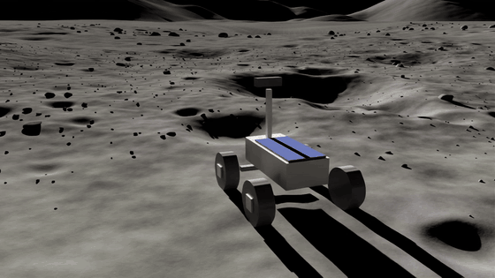

# isaac-lunar-rover-sim

A lunar rover simulator for NVIDIA Isaac Sim 6.0.1, built as the environment for later vision-language-action (VLA)
research. Version 1 is the simulation environment only; the learning-facing layer (gym wrapper, episode recorder,
tasks, language) comes once the environment is trusted. Design: [docs/DESIGN.md](docs/DESIGN.md).

## Demo

8 s drive on the Apollo 17 valley floor (preset `gpu_8gb`, Sun 15° above the eastern horizon), rendered headless with
`scripts/render_drive_video.py`. Click a preview for the full-quality MP4.

| Chase camera | Rover front camera (what a policy would see) |
|---|---|
| [](docs/videos/rover_drive_chase.mp4) | [](docs/videos/rover_drive_front_camera.mp4) |

Watch for the wheel tracks with grouser imprints forming behind the rover during the left turn, rocks casting long
shadows, and the North and South Massifs (real DTM heights) on the horizon.


*Camera glare (`render.sun_glare`): glare off, then bloom scale 0.15 / 0.3 / 0.6 (default). Only the Sun blooms; the
terrain brightness is unchanged.*

## What it does

- **Terrain from LROC NAC DTMs** (Apollo 17, 2 m + 5 m mosaic) in a true-metre local frame, nested tiers out to the
  horizon (2.5 cm workspace, 0.2 m near ring, 4 m regional, 64 m backdrop) with exact triangle-mesh colliders.
- **Procedural sub-DEM relief** (SYNTHETIC): equilibrium crater population with diffusion degradation and
  band-limited fractal relief, calibrated to the DEM's own roughness; the DEM's resolved band is left untouched.
- **Rocks** (SYNTHETIC): procedural fractured-ellipsoid shapes, blended background + boulder-tail size-frequency law,
  clustering, burial and regolith fillets; pebbles to boulders, convex-hull colliders, semantic labels, registry in
  the scene manifest.
- **Regolith**: back-scattering lunar MDL, macro albedo and micro-relief textures, SYNTHETIC soil property maps.
- **Wheel tracks**: ruts with grouser imprints and berms carved into the rendered mesh, depth from Bekker sinkage on
  the soil maps, plus a track mask that changes albedo and smoothness. Ruts are visual; the collider is not deformed.
- **Rover**: procedural 55 kg four-wheel skid-steer with a passive front-axle pivot, closed-loop yaw rate, cameras,
  lunar gravity, camera glare (bloom) for the Sun.

## Requirements

Linux, an NVIDIA RTX GPU (verified on an 8 GB RTX 5060), Isaac Sim 6.0.1 pip install, the LROC NAC Apollo 17 DTMs.

```bash
cp .env.example .env.local && $EDITOR .env.local      # ISAAC_ENV, data root on a large disk, DEM directory
scripts/setup_data_root.sh                            # creates the data root (refuses the root disk)
$ISAAC_ENV/bin/python scripts/bake_scene.py --preset gpu_8gb     # Isaac-free bake (~40 s) -> <data root>/scenes/
```

## Run

```bash
scripts/isaac_run.sh --interactive scripts/view_scene.py --preset gpu_8gb   # drive with W/A/S/D (X stop, R reset, C camera)
scripts/isaac_run.sh scripts/render_drive_video.py --preset gpu_8gb         # chase + front-camera MP4
scripts/isaac_run.sh tests/isaac/smoke_terrain_drive.py --preset gpu_8gb    # terrain, colliders, rocks, wheels follow ground
scripts/isaac_run.sh tests/isaac/smoke_wheel_tracks.py --preset gpu_8gb     # tracks visible in renders
scripts/isaac_run.sh scripts/render_sun_glare_check.py                      # camera glare comparison PNG
```

Presets: `smoke` (small, fast), `gpu_8gb` (default), `gpu_32gb` (RTX 5090; extrapolated, not yet run).

## Honest limits

All sub-DEM detail, rocks and soil properties are synthetic and uncalibrated. Wheels do not physically sink into
their ruts. Skid steering scrubs heavily, so yaw rate is closed-loop while forward speed in arcs is open-loop.
